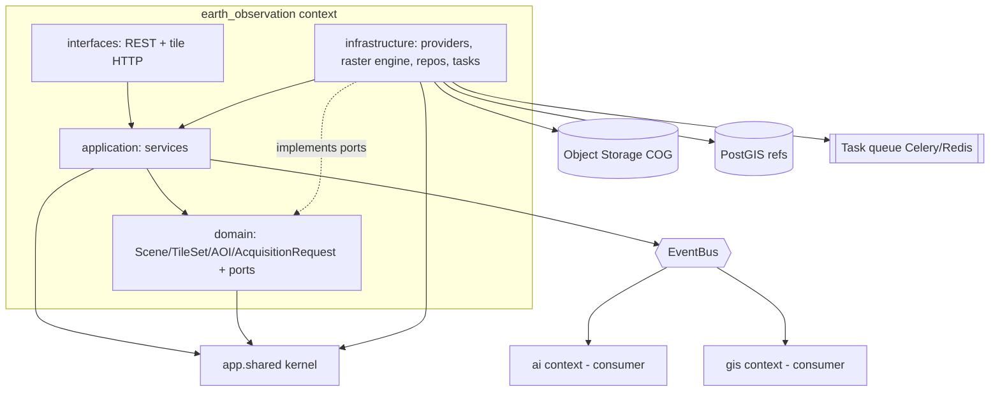
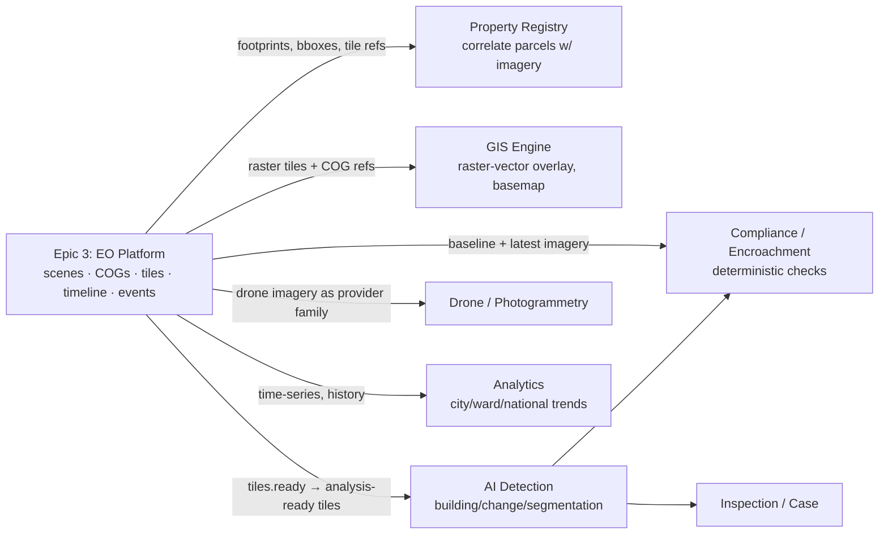

# SATRAK — Epic 3: Earth Observation Platform

## Architecture & Implementation Specification

- **Status:** Draft for review (design sprint — **no code produced**)
- **Author role:** Principal Architect (Software / GIS / EO / Remote Sensing / Data & AI Platform / Cloud)
- **Date:** 2026-07-06
- **Applies to:** SATRAK `v0.2.0-alpha` (Core Domain Platform complete — ADR-0001..0004)
- **Scope:** The reusable, provider-agnostic **Earth Observation (EO) Platform** — imagery acquisition, raster processing, storage, metadata, time-series, tiles, and background jobs. **Explicitly out of scope:** authentication, compliance, AI detection, building segmentation, case management, reports, dashboards, frontend.
- **Governing decisions this document must not contradict:** `PRD.md`, `TDD.md`, `ENGINEERING_BLUEPRINT.md`, `apps/api/ARCHITECTURE.md`, ADR-0001..0004.

> **This is a specification, not an implementation.** It defines the contract for the
> implementation epic that follows. It creates no tables, no APIs, no frontend, and
> modifies no existing source. Where the design necessarily _extends_ the platform, it
> does so as a _proposal_ to be ratified by the embedded ADRs (Appendix A).

> **Amendment (2026-07-06, ratified) — drone scope.** Appendix A's proposed ADRs are now
> ratified as ADR-0005..0009, and the naming review [ADR-0010](adr/0010-context-naming-review-earth-observation-vs-satellite.md)
> **corrected the drone scope**: Earth Observation owns **satellite + manned aerial**
> imagery only. **All drone/UAV imagery stays in the `drone` context.** Wherever this
> document says "drone imagery as an EO provider family" (e.g. §3.3, §20, Appendix A),
> read it as **drone reuses the shared imagery/raster packages, not the EO context**. The
> reusable raster/CRS/imagery abstractions live in `packages/py-geo`, `packages/py-raster`,
> and `packages/py-imagery`.

---

## Section 0 — Reconciliation & Consistency Findings

The prompt requires reading the source-of-truth documents and **listing inconsistencies
without modifying anything**. The following were found while grounding this design.

### 0.1 Findings (surfaced, not resolved here)

| #   | Finding                                                                                                                                                                                                                                                                                                                                                                               | Evidence                                                      | Recommended handling (proposal only)                                                                                                                                                                                                                                                                                                                              |
| --- | ------------------------------------------------------------------------------------------------------------------------------------------------------------------------------------------------------------------------------------------------------------------------------------------------------------------------------------------------------------------------------------- | ------------------------------------------------------------- | ----------------------------------------------------------------------------------------------------------------------------------------------------------------------------------------------------------------------------------------------------------------------------------------------------------------------------------------------------------------- |
| F-1 | **Epic numbering mismatch.** This prompt calls the EO work "Epic 3." The Blueprint (Part 7) uses Epic 3 = _Property & Parcel Management_ and Epic 5 = _Satellite Engine_. The TDD/Blueprint have no "Earth Observation" epic at all.                                                                                                                                                  | `ENGINEERING_BLUEPRINT.md` Part 7, Epics 3 & 5                | Treat "Epic 3 = Earth Observation Platform" as this program's local label. Map it to the Blueprint's **Epic 5 (Satellite Engine)**, generalized. This document uses "Epic 3 (EO Platform)" throughout and notes the mapping.                                                                                                                                      |
| F-2 | **Architecture style: microservices vs modular monolith.** TDD §16 ADR-01 says "Microservices over Monolith." `docs/adr/0003` supersedes this with "Modular Monolith First."                                                                                                                                                                                                          | TDD §16 ADR-01 vs ADR-0003                                    | ADR-0003 is the newer, governing decision and _explicitly_ reconciles the TDD. This spec follows **ADR-0003**: EO ships inside `apps/api` as a bounded context; `services/satellite` remains the reserved extraction target.                                                                                                                                      |
| F-3 | **No "earth_observation" context is reserved.** The Blueprint/ADR-0003 reserve `satellite` and `drone` as _separate_ contexts. The prompt's Section 4 asks for a single `contexts/earth_observation/` context spanning satellite + drone + aerial.                                                                                                                                    | ADR-0003 "Context boundaries (authoritative list)"; prompt §4 | See **ADR-EO-001** (Appendix A): adopt `earth_observation` as the imagery-platform context, treating the reserved `satellite` placeholder as its acquisition sub-domain and keeping drone **photogrammetry** in the `drone` context (drone _imagery_ is an EO provider family). This is a _proposed_ extension to the authoritative context list, to be ratified. |
| F-4 | **Scheduler technology: Airflow vs Celery.** TDD §3.6 names _Apache Airflow_ for acquisition scheduling; Blueprint §2.7 names _Celery beat_ + Celery task chains.                                                                                                                                                                                                                     | TDD §3.6 vs Blueprint §2.7                                    | See **ADR-EO-004**: standardize on **Celery (beat + chains)** behind the existing `TaskQueue` port; keep Airflow as a future option for complex DAGs. The `TaskQueue` abstraction (already in the shared kernel) makes this reversible.                                                                                                                           |
| F-5 | **Provider list divergence.** The prompt asks for Sentinel-1/2, Landsat, Planet, Maxar, Airbus, Cartosat, Bhuvan, Google Earth Engine. TDD §7 speaks generically of "national EO satellites" + "Maxar/Planet-class." No conflict, but the prompt's list is broader and includes SAR (Sentinel-1) and an analysis platform (GEE) that behave differently from optical scene providers. | prompt §5 vs TDD §7                                           | The provider abstraction (Section 5) is designed to absorb all of these via **capability descriptors**, not a fixed enum. SAR and GEE are called out as distinct capability profiles.                                                                                                                                                                             |
| F-6 | **Storage: no PostGIS raster.** TDD §9 / Blueprint Part 5 mandate COGs in object storage with PostGIS holding only _references_ (`tile_index`, `satellite_scenes`).                                                                                                                                                                                                                   | Blueprint Part 5 "Raster Data"                                | Not an inconsistency — a hard constraint. This spec adopts it verbatim (Section 7 & 13). Called out so implementers do not introduce `postgis_raster`.                                                                                                                                                                                                            |

**No documents were modified.** These findings are recorded here for the maintainers to
resolve during ratification.

### 0.2 Hard constraints inherited (non-negotiable)

1. **Dependency rule (machine-enforced by import-linter):** `api`/`db` → `contexts` → `shared`. `shared` imports only stdlib. Contexts depend only on `shared` and **never on each other**; they collaborate via **ids + domain events**. (`apps/api/ARCHITECTURE.md`)
2. **Events dispatched by the Unit of Work after commit**, never from inside the domain model. `EventBus` is broker-agnostic (`InMemoryEventBus` now → Kafka later). (ADR-0002)
3. **Audit envelope on every entity** (`id`, `created_at/by`, `updated_at/by`, `version`, soft-delete) via `VersionedEntity`. (ADR-0002)
4. **Reuse existing shared-kernel ports** — do **not** invent parallel abstractions. The relevant ports already exist: `StorageProvider`, `TaskQueue`, `Cache`, `SearchIndex`, `AuditSink`, `Clock`, `IdGenerator`, `EventPublisher`. (see `apps/api/app/shared/services/`)
5. **Reuse existing geospatial value objects** — `Coordinates`, `GeoPoint`, `BoundingBox` (WGS84 default), `FileReference` (`checksum_sha256`, `FileCategory`). Do not redefine them. (`apps/api/app/shared/value_objects/`)
6. **Raster pixels never in PostGIS.** COGs live in object storage; PostGIS stores references only. (Blueprint Part 5)
7. **CRS discipline:** store/compute in a **national projected CRS**; interchange in **WGS84 (EPSG:4326)**. The transform boundary lives in exactly one place. (Blueprint Part 5)
8. **RFC 9457 Problem Details** for all API errors, with `code` + `request_id`. (ADR-0002)

---

## Section 1 — Business Goals

### 1.1 Why the EO Platform exists

SATRAK's mission is nationwide detection of unauthorized/illegal construction. Every
downstream capability — AI detection, change detection, encroachment checks, case
evidence, analytics — is a **function of imagery over time**. Without a reliable,
auditable, provider-agnostic supply of _analysis-ready_ imagery, nothing downstream can
run. The EO Platform is that supply. It is deliberately designed as a **horizontal
capability** (like the shared kernel) rather than a feature, because at least five future
epics consume it.

### 1.2 Problems it solves

| Problem                                                                                                                                                                | Without the platform                                                    | With the platform                                                                    |
| ---------------------------------------------------------------------------------------------------------------------------------------------------------------------- | ----------------------------------------------------------------------- | ------------------------------------------------------------------------------------ |
| **Heterogeneous providers** (Sentinel, Landsat, Planet, Maxar, Airbus, Cartosat, Bhuvan, GEE) each have different auth, tasking, formats, band layouts, and licensing. | Every consumer re-implements provider glue; licensing leaks everywhere. | One `ImageryProvider` port; normalized metadata; capability-driven routing.          |
| **Raster is heavy** (TB/day at national scale).                                                                                                                        | Ad-hoc downloads, no dedup, no COG discipline, DB bloat.                | Content-addressed storage, COG-only processed tier, references-in-DB.                |
| **Legal defensibility** requires provenance + integrity + "what did the imagery show at time T."                                                                       | Untraceable pixels → inadmissible evidence.                             | Immutable provenance, SHA-256 integrity, append-versioned time-series, audit events. |
| **Consistent AI input** — models need fixed tiling, CRS, band order.                                                                                                   | Model accuracy varies by ingestion path.                                | Deterministic preprocessing → analysis-ready COGs on a fixed tile grid.              |
| **Cost control** — commercial tasking is expensive.                                                                                                                    | Redundant tasking, no cache, no dedup.                                  | Discovery-before-tasking, dedup by scene id + checksum, tiered retention.            |

### 1.3 How it fits into SATRAK

```
        ┌───────────────────────────────────────────────────────────────┐
        │                     SATRAK Modular Monolith                    │
        │                        (apps/api, ADR-0003)                    │
        │                                                                │
        │   identity   organization   property   gis   compliance  ...   │
        │      │            │            │        │         │            │
        │      └────────────┴─────┬──────┴────────┴─────────┘            │
        │                         │ consume imagery + tiles + events     │
        │            ┌────────────▼─────────────┐                        │
        │            │  earth_observation ctx   │  ◀── THIS EPIC         │
        │            │  (EO Platform)           │                        │
        │            └────────────┬─────────────┘                        │
        │                         │ uses shared-kernel ports             │
        │   shared kernel: StorageProvider · TaskQueue · EventBus ·      │
        │                  Cache · Search · Audit · Clock · IdGen        │
        └───────────────────────────────────────────────────────────────┘
                 │                         │                    │
          Object Storage             PostGIS (refs)        Broker/Queue
          (MinIO/S3, COG)           satellite_scenes…      (Celery/Redis→Kafka)
```

The EO Platform is a **producer**: it emits `tiles.ready` / `scene.ingested` events (per
Blueprint §2.7) that the AI, GIS, and case contexts consume. It is a **peer context** —
it never imports another context; consumers correlate via ids + events.

### 1.4 Success metrics

| Metric                             | Target                                                                                        | Source                                                |
| ---------------------------------- | --------------------------------------------------------------------------------------------- | ----------------------------------------------------- |
| Acquisition → analysis-ready tiles | **≤ 30 min per scene**                                                                        | TDD §13                                               |
| Tile serve latency (p95, cached)   | ≤ 100 ms                                                                                      | derived from TDD §13 read targets                     |
| Scene metadata query (p95)         | ≤ 200 ms                                                                                      | TDD §13 (spatial query)                               |
| Ingestion throughput               | **TB/day**, burst after each revisit pass                                                     | TDD §3.6                                              |
| Storage efficiency                 | 0 duplicate scenes (dedup by provider scene id + checksum); processed tier COG-only           | Blueprint Part 5                                      |
| Provenance completeness            | 100% of stored assets have provider, sensor, acquisition time, checksum, CRS, bbox            | TDD §7 "provenance metadata attached to every output" |
| Reprocessing correctness           | Re-running a pipeline version is deterministic & idempotent (same inputs → same content hash) | this spec §6/§12                                      |
| Provider isolation                 | Adding a new provider touches only `providers/<name>/` — zero changes elsewhere               | this spec §5                                          |

---

## Section 2 — Architecture

### 2.1 Layered view (obeys the dependency rule)

```
 earth_observation/
 ┌─────────────────────────────────────────────────────────────────────┐
 │ interfaces/   API routers, DTOs, tile HTTP handlers   (outermost)    │  → depends inward only
 ├─────────────────────────────────────────────────────────────────────┤
 │ infrastructure/  provider adapters, raster engine (GDAL/rasterio),   │
 │                  SQLAlchemy repos, storage keying, Celery tasks       │
 ├─────────────────────────────────────────────────────────────────────┤
 │ application/   use-cases/services: Acquisition, Preprocessing,        │
 │                Tiling, MetadataExtraction, Timeline, Retention        │
 ├─────────────────────────────────────────────────────────────────────┤
 │ domain/        aggregates (Scene, TileSet, AOI, AcquisitionRequest),  │  (innermost of ctx)
 │                value objects, domain events, ports (provider,         │
 │                raster-engine, tile-store as Protocols)                 │
 └─────────────────────────────────────────────────────────────────────┘
        depends on ──►  app.shared.*  (kernel: entities, VOs, ports)
```

> The context's own `domain/` may **not** import `rasterio`, `GDAL`, `boto3`, or FastAPI.
> Those live in `infrastructure/`. The raster engine and providers are exposed to the
> domain/application layers as **Protocols (ports)**; concrete GDAL/rasterio adapters
> satisfy them. This mirrors how `StorageProvider` is a port with an in-memory fake.

### 2.2 Module relationships & dependencies



**Rules:**

- `earth_observation` imports **only** `app.shared` — never `gis`, `property`, `ai`, `drone`.
- Consumers of imagery **never import** `earth_observation` internals; they subscribe to its events and call its public API/DTOs.
- Providers, raster engine, and tile store are **ports in `domain/`**, adapters in `infrastructure/` — swap without touching business logic.

### 2.3 Event flow (acquisition → availability)

```mermaid
sequenceDiagram
    participant Sched as AcquisitionScheduler (Celery beat)
    participant Prov as ImageryProvider (adapter)
    participant Dl as DownloadWorker
    participant Val as Validation
    participant Meta as MetadataExtractor
    participant Store as StorageProvider (S3/MinIO)
    participant Pre as PreprocessingPipeline
    participant Tile as TilingService
    participant Bus as EventBus (UoW-dispatched)

    Sched->>Prov: search(AOI, time window, capability filter)
    Prov-->>Sched: candidate scenes (normalized metadata)
    Sched->>Bus: ImageDiscovered
    Sched->>Dl: enqueue download(scene_ref)
    Dl->>Prov: fetch bytes (chunked/streamed)
    Dl->>Store: put raw (content-addressed key)
    Dl->>Bus: ImageDownloaded
    Dl->>Val: checksum + completeness + format
    Val->>Bus: ImageValidated (or ImageRejected)
    Val->>Meta: extract metadata (GDAL)
    Meta->>Bus: MetadataExtracted
    Meta->>Store: (scene registered; refs to PostGIS)
    Meta->>Bus: ImageStored
    Store->>Pre: enqueue preprocess(scene_id, pipeline_version)
    Pre->>Pre: mask → orthorectify → normalize → COG
    Pre->>Tile: enqueue tile(scene_id)
    Tile->>Store: write tiles/pyramids (COG overviews)
    Tile->>Bus: TileGenerated / tiles.ready
    Note over Bus: tiles.ready triggers AI context (downstream epic)
```

All events are recorded on aggregates and **published by the UoW on commit** — a failed
download never emits `ImageDownloaded` (no dual-write). This is the ADR-0002 pattern
applied unchanged.

### 2.4 Data flow & storage flow

```
 Provider API ──raw bytes──► [raw/ tier]  (immutable, content-addressed, checksummed)
                                  │
                            validate + extract metadata ──► PostGIS: satellite_scenes (ref row)
                                  │
                         preprocessing pipeline (versioned)
                                  │
                                  ▼
                            [processed/ tier: analysis-ready COG]
                                  │
                             tiling + pyramids
                                  │
                                  ▼
                            [tiles/ tier: COG overviews / XYZ]  ──► PostGIS: tile_index (ref rows)
                                  │
                     thumbnails/  exports/  archive/  temporary/
```

Only **references** (URIs, bboxes, checksums, acquisition dates, scene ids) enter PostGIS.
Pixels always live in object storage and are read via range requests (COG) directly by
consumers. (Blueprint Part 5.)

### 2.5 Background-jobs view

Two Celery queues by resource profile (extends the `TaskQueue` port):

```
 io_queue   → discovery, download, validation, thumbnail, metadata, cleanup
 cpu_queue  → preprocessing (mask/ortho/normalize), tiling, pyramids, reprocessing
 (future) gpu_queue for ML-backed cloud masking; not in this epic
```

Celery **beat** drives scheduled discovery per AOI revisit cadence; a Celery **chain**
implements `download → validate → metadata → preprocess → tile`. Backlog-priority
reordering during cloud-heavy periods (Blueprint §2.7) is a queue-priority policy, not new
infrastructure. Detailed in Section 12.

---

## Section 3 — Bounded Context

**Decision: ONE bounded context — `earth_observation` — with internal sub-domains.**
(Ratified by ADR-EO-001, Appendix A.)

### 3.1 Rationale

- **Cohesion:** discovery, download, storage, metadata, raster processing, tiling, and
  time-series all mutate the _same_ core aggregate (`Scene`) and share the _same_
  ubiquitous language (scene, band, tile, AOI, pyramid, COG). Splitting them creates
  chatty cross-context calls over a single lifecycle — the opposite of a clean seam.
- **Provider-agnosticism:** satellite, drone, and aerial imagery differ in _acquisition_
  but converge on identical _raster/storage/tile/metadata_ machinery. Modeling them as
  **provider families** inside one context maximizes reuse — the prompt's central goal.
- **Matches existing granularity:** the shared kernel + a handful of coarse contexts
  (`identity`, `organization`, `core`) is the established grain; eleven micro-contexts is
  not.

### 3.2 Why not several contexts

| Alternative                                                                                   | Verdict                               | Reason                                                                                                                                                                                                                   |
| --------------------------------------------------------------------------------------------- | ------------------------------------- | ------------------------------------------------------------------------------------------------------------------------------------------------------------------------------------------------------------------------ |
| Split `ingestion` vs `preprocessing` vs `tiles` as 3 contexts (mirrors TDD §3.6/3.7 services) | **Rejected for the context boundary** | They share one aggregate lifecycle; the TDD's _service_ split is a **deployment** concern, not a **domain** boundary. Keep them as sub-domains now; they remain independently extractable as _modules_ later (ADR-0003). |
| Fold EO into the reserved `satellite` context as-is                                           | **Rejected**                          | `satellite` name excludes drone/aerial, which the platform must serve. `earth_observation` generalizes it.                                                                                                               |
| Put raster engine in the shared kernel                                                        | **Rejected**                          | The kernel imports only stdlib (import-linter). GDAL/rasterio are heavy infra deps; they belong in `earth_observation/infrastructure/`, exposed as a **port** the kernel-style code can depend on.                       |

### 3.3 Sub-domains within the one context

`providers` · `acquisition` · `raster` · `metadata` · `storage` · `timeline` · `tiles` ·
`jobs`. Each is a package folder (Section 4), **not** a separate bounded context. Drone
_imagery ingestion_ is a provider family here; drone **photogrammetry** (SfM, point
clouds, DSM) stays in the reserved `drone` context (different aggregate, different compute
profile — GPU photogrammetry) and consumes EO tiles/orthomosaics via events.

### 3.4 Relationship to reserved contexts (`satellite`, `gis`, `drone`)

- `satellite` placeholder → **subsumed** by `earth_observation` as its acquisition
  sub-domain (proposed; see F-3 / ADR-EO-001). The `services/satellite` extraction target
  is renamed/aliased to `services/earth_observation` at ratification.
- `gis` → **peer consumer**. EO writes raster references; GIS owns vector layers, MVT, and
  spatial queries. EO does **not** do vector tiles or spatial predicates.
- `drone` → **peer consumer/producer**. Drone imagery enters EO as a provider; drone 3D
  products stay in `drone`.

---

## Section 4 — Folder Structure

Authoritative home (ADR-0003): `apps/api/app/contexts/earth_observation/`. Reserved
extraction target: `services/earth_observation/` (renamed from `services/satellite`).

```
apps/api/app/contexts/earth_observation/
├── __init__.py
├── domain/                          # PURE — imports only app.shared + stdlib
│   ├── aggregates/
│   │   ├── scene.py                 # Scene aggregate root (lifecycle, events)
│   │   ├── tile_set.py              # TileSet aggregate (tiles for a scene/pyramid)
│   │   ├── aoi.py                   # AreaOfInterest aggregate (monitored footprint)
│   │   └── acquisition_request.py   # tasking/scheduling request aggregate
│   ├── value_objects/
│   │   ├── band.py                  # Band, BandSet, spectral index descriptors
│   │   ├── resolution.py            # GSD (ground sample distance)
│   │   ├── acquisition.py           # AcquisitionMeta: sensor, sun angle, cloud%
│   │   ├── crs.py                   # CrsRef (EPSG) + national-CRS marker
│   │   ├── scene_id.py              # ProviderSceneId (provider + native id)
│   │   ├── quality.py               # QualityScore, CloudCoverPct
│   │   └── tile_coord.py            # TileCoord (z,x,y), TileMatrixSet ref
│   ├── enums.py                     # SceneStatus, ProcessingStatus, AssetTier, SensorType
│   ├── events.py                    # ImageDiscovered … TileGenerated … ImageArchived
│   └── ports/                       # PROTOCOLS (interfaces) the ctx depends on
│       ├── imagery_provider.py      # ImageryProvider port (search/task/fetch/capabilities)
│       ├── raster_engine.py         # RasterEngine port (crop/warp/cog/pyramids/stats)
│       ├── tile_store.py            # TileStore port (put/get/exists tile)
│       ├── scene_repository.py      # SceneRepository port
│       ├── tile_index_repository.py # TileIndexRepository port
│       └── aoi_repository.py        # AoiRepository port
├── application/                     # USE-CASES — depend on domain + shared ports
│   ├── acquisition/
│   │   ├── discover_scenes.py       # search providers for an AOI/time window
│   │   ├── schedule_acquisition.py  # AcquisitionSchedulerService
│   │   └── request_tasking.py       # commercial tasking request flow
│   ├── ingestion/
│   │   ├── download_scene.py
│   │   ├── validate_scene.py
│   │   └── register_scene.py        # persists refs, emits ImageStored
│   ├── metadata/extract_metadata.py # MetadataExtractionService
│   ├── preprocessing/
│   │   ├── preprocess_scene.py      # PreprocessingService (pipeline orchestration)
│   │   └── pipeline_spec.py         # declarative, versioned pipeline definition
│   ├── tiling/generate_tiles.py     # TilingService
│   ├── timeline/query_timeline.py   # TimelineService (history per AOI/geometry)
│   ├── retention/apply_retention.py # RetentionService (archive/delete policy)
│   └── dto.py                       # application DTOs (no framework types)
├── infrastructure/                  # ADAPTERS — the only place heavy libs appear
│   ├── providers/
│   │   ├── base.py                  # shared HTTP client, auth, retry, rate-limit
│   │   ├── sentinel/                # Sentinel-1 (SAR) + Sentinel-2 (optical)
│   │   ├── landsat/
│   │   ├── planet/
│   │   ├── maxar/
│   │   ├── airbus/
│   │   ├── cartosat/                # ISRO Cartosat
│   │   ├── bhuvan/                  # ISRO Bhuvan / NRSC
│   │   ├── gee/                     # Google Earth Engine (compute-side provider)
│   │   └── registry.py             # capability-based provider resolution
│   ├── raster/
│   │   ├── gdal_engine.py           # RasterEngine impl (GDAL/rasterio)
│   │   ├── cog.py                   # COG creation/validation
│   │   ├── cloud_mask.py            # Fmask-style / s2cloudless adapter
│   │   ├── warp.py                  # reproject/orthorectify (DEM-based)
│   │   └── stats.py                 # histograms, zonal-ready statistics
│   ├── tiles/
│   │   ├── cog_tile_store.py        # serves XYZ tiles from COG range reads
│   │   └── tile_matrix.py           # WebMercatorQuad / WMTS matrix sets
│   ├── persistence/
│   │   ├── models.py                # SQLAlchemy ORM (refs only; VersionedEntity mixins)
│   │   ├── scene_repository.py      # SceneRepository adapter
│   │   ├── tile_index_repository.py
│   │   └── aoi_repository.py
│   ├── storage/keying.py            # content-addressed key scheme (Section 7)
│   └── tasks/                       # Celery tasks wiring the TaskQueue port
│       ├── celery_app.py
│       ├── acquisition_tasks.py
│       ├── ingestion_tasks.py
│       ├── preprocessing_tasks.py
│       ├── tiling_tasks.py
│       └── retention_tasks.py
├── interfaces/                      # BOUNDARY (FastAPI) — mounted under api/v1
│   ├── routers/
│   │   ├── scenes.py                # /satellite/scenes (search/metadata/status)
│   │   ├── tiles.py                 # /satellite/tiles/{z}/{x}/{y}
│   │   ├── aoi.py                   # /satellite/aoi (admin)
│   │   └── timeline.py              # /satellite/timeline
│   └── schemas.py                   # pydantic response/request DTOs
└── README.md                        # boundary doc (mirrors satellite/README.md style)
```

### 4.1 Folder responsibilities

| Folder                       | Responsibility                                                                                  | May import                           |
| ---------------------------- | ----------------------------------------------------------------------------------------------- | ------------------------------------ |
| `domain/aggregates`          | Consistency boundaries; record events; enforce invariants via `_check_invariants()` (ADR-0002). | `app.shared`, sibling domain, stdlib |
| `domain/value_objects`       | Immutable, self-validating VOs specific to EO (bands, GSD, tile coords).                        | `app.shared` VOs, stdlib             |
| `domain/ports`               | Protocols for provider, raster engine, tile store, repositories.                                | `app.shared`, stdlib                 |
| `application/*`              | Orchestrate use-cases; depend on ports; own transactions via UoW.                               | `domain`, `app.shared`               |
| `infrastructure/providers`   | Provider adapters (auth, rate-limit, retry, metadata normalization).                            | GDAL/rasterio/httpx/provider SDKs    |
| `infrastructure/raster`      | GDAL/rasterio raster engine adapter.                                                            | GDAL, rasterio, numpy                |
| `infrastructure/tiles`       | COG-backed XYZ/WMTS tile production & serving.                                                  | rasterio, morecantile                |
| `infrastructure/persistence` | SQLAlchemy repos mapping refs to `VersionedEntity`.                                             | SQLAlchemy, GeoAlchemy2              |
| `infrastructure/tasks`       | Celery wiring behind the `TaskQueue` port.                                                      | Celery                               |
| `interfaces/*`               | FastAPI routers + DTOs; map domain errors → Problem Details.                                    | FastAPI, `app.core`                  |

---

## Section 5 — Provider Architecture

### 5.1 The `ImageryProvider` port (domain-level Protocol)

Modeled after the existing `StorageProvider`/`TaskQueue` ports (Protocol + in-memory fake).
It is **capability-driven**, not a fixed enum, so SAR (Sentinel-1), optical scene
providers (Sentinel-2/Landsat/Maxar/Airbus/Planet/Cartosat), archive/basemap sources
(Bhuvan), and compute platforms (GEE) all fit.

```
ImageryProvider (Protocol)
  capabilities() -> ProviderCapabilities        # what this provider can do
  search(AoiFootprint, TimeWindow, filters) -> list[SceneCandidate]
  task(AoiFootprint, TaskingSpec) -> AcquisitionRequestRef   # commercial tasking (optional)
  fetch(SceneRef) -> AsyncByteStream             # chunked/streamed download
  normalize(raw_metadata) -> SceneMetadata       # provider-specific → canonical
```

`ProviderCapabilities` (a value object) declares: sensor type(s) (optical/SAR/hyperspectral),
resolution range (GSD), bands, revisit cadence, tasking-supported (bool), max AOI,
delivery format (SAFE/GeoTIFF/COG/NITF), licensing tier, cost model, auth scheme, and
async-vs-sync fetch. The `ProviderRegistry` resolves the **best** provider for a request
by matching required capabilities (e.g., "sub-meter optical, cloud<10%, ≤48h") — this is
the "capability detection" the prompt asks for.

### 5.2 Provider matrix

| Provider                   | Sensor             | Native GSD                 | Format              | Auth                | Tasking | Notes                                                                  |
| -------------------------- | ------------------ | -------------------------- | ------------------- | ------------------- | ------- | ---------------------------------------------------------------------- |
| **Sentinel-2**             | Optical (13 bands) | 10/20/60 m                 | SAFE→COG            | OAuth (CDSE) / STAC | No      | Free, high-revisit baseline monitoring                                 |
| **Sentinel-1**             | **SAR** (C-band)   | 5–40 m                     | SAFE (GRD/SLC)      | OAuth (CDSE)        | No      | All-weather; distinct capability profile (no cloud%, has polarization) |
| **Landsat 8/9**            | Optical            | 15/30 m                    | GeoTIFF (USGS/STAC) | API key / STAC      | No      | Long archive for time-series baselines                                 |
| **Planet**                 | Optical            | 3–5 m (PS), 0.5 m (SkySat) | GeoTIFF/COG         | API key             | Yes     | Daily revisit; commercial                                              |
| **Maxar**                  | Optical            | 0.3–0.5 m                  | GeoTIFF/NITF        | OAuth/API key       | Yes     | Sub-meter verification imagery                                         |
| **Airbus (Pléiades/SPOT)** | Optical            | 0.5–1.5 m                  | JP2/GeoTIFF         | OAuth (OneAtlas)    | Yes     | Sub-meter verification                                                 |
| **Cartosat (ISRO)**        | Optical            | 0.25–2.5 m                 | GeoTIFF             | Gov contract/API    | Yes     | National high-res                                                      |
| **Bhuvan (ISRO/NRSC)**     | Optical / basemap  | varies                     | WMS/WMTS/GeoTIFF    | Gov API key         | No      | National archive + basemap                                             |
| **Google Earth Engine**    | Compute platform   | varies                     | server-side         | Service account     | N/A     | Compute-side provider (§5.7)                                           |
| **Future**                 | any                | any                        | any                 | any                 | any     | Added under `providers/<name>/` only                                   |

### 5.3 Authentication

- Credentials **never** in code or images. Loaded via the platform config layer
  (`pydantic-settings`, `SATRAK_EO_<PROVIDER>_*`), sourced from `.env` (dev) or the
  KMS-backed secrets manager (staging/prod) — same pattern as Blueprint Part 6.
- Per-provider auth strategies behind a common `ProviderAuth` interface: `ApiKeyAuth`,
  `OAuth2ClientCredentials` (token cache + refresh), `ServiceAccountAuth` (GEE), `StaticBearer`.
- Tokens cached in the shared `Cache` port with TTL = token expiry − safety margin.

### 5.4 Rate limiting & retries

- **Rate limiting:** token-bucket per provider (config: rps, burst) in the `providers/base.py`
  HTTP client. Prevents a burst acquisition pass from tripping provider quotas.
- **Retries:** exponential backoff with full jitter; retry only idempotent/safe status
  classes (429, 5xx, connection resets). Honor `Retry-After`. Cap attempts; on exhaustion
  emit `ImageRejected` with a reason and route to a dead-letter queue.
- **Circuit breaker** per provider: open on sustained failures so a down provider does not
  starve the queue; the registry can fail over to an alternate capable provider.
- **Idempotency:** download keyed by content-addressed target; a retried download that
  already produced a validated object short-circuits (no re-fetch).

### 5.5 Metadata normalization

Every provider's `normalize()` maps native metadata → the canonical `SceneMetadata` VO
(Section 8). This is the single most important provider responsibility: downstream code
never sees provider-specific fields. Where a provider lacks a field (e.g., Sentinel-1 has
no cloud%), the canonical model uses `None` + a `sensor_type` discriminator so consumers
branch on capability, not provider name. **Prefer STAC** where available — most providers
(Sentinel/Landsat/Planet) expose STAC Items, which map almost 1:1 to `SceneMetadata`,
minimizing bespoke code.

### 5.6 Download strategy

- **Discovery before download** (and before _tasking_, for paid providers) to avoid
  redundant fetches — check `satellite_scenes` for an existing validated scene id first.
- **Streamed, chunked** transfer to the raw tier; never buffer a multi-GB scene fully in
  memory (chunk to object storage via multipart). See Section 17.
- **Parallelism** bounded per provider by the rate limiter and a global download-concurrency
  semaphore.
- **Resume** partial downloads where the provider supports range requests.
- **Verify on arrival:** checksum + expected size + format sniff before marking downloaded.

### 5.7 Google Earth Engine — a distinct "compute-side" provider

GEE does not deliver files the same way; computation happens server-side and results are
exported. It is modeled as an `ImageryProvider` whose `fetch()` triggers a **GEE export
task** to object storage (or an EE→COG export), then ingests the exported asset through the
normal lifecycle. Its `capabilities()` flags `compute_side=True` so the scheduler treats
latency/async semantics differently. This keeps GEE inside the same abstraction without
special-casing the core.

### 5.8 Adding a future provider (the acceptance test for the abstraction)

1. Create `infrastructure/providers/<name>/` implementing `ImageryProvider`.
2. Declare `ProviderCapabilities`.
3. Register in `registry.py`.
4. Add config keys + secret entries.

> **Zero changes** to domain, application, tiling, storage, or API layers. If a new
> provider forces a change outside `providers/<name>/`, the abstraction has leaked —
> treat as a design bug.

---

## Section 6 — Image Lifecycle

### 6.1 State machine (`SceneStatus` / `ProcessingStatus`)

```
 DISCOVERED ─► REQUESTED ─► DOWNLOADING ─► DOWNLOADED ─► VALIDATED ─► REGISTERED
                                   │             │            │
                                   ▼(fail)       ▼(fail)      ▼(reject)
                               REJECTED ◄────────┴────────────┘
 REGISTERED ─► PREPROCESSING ─► PROCESSED ─► TILING ─► AVAILABLE
                     │              │           │
                     ▼(fail)        │           ▼(fail)
                   FAILED ◄─────────┴───────────┘   (retry-able)
 AVAILABLE ─► (reprocess: new pipeline version → new PROCESSED variant)
 AVAILABLE ─► ARCHIVED ─► DELETED   (retention policy)
```

### 6.2 Stages

| #   | Stage                    | What happens                                                                                                           | Emits                              | Idempotency key                           |
| --- | ------------------------ | ---------------------------------------------------------------------------------------------------------------------- | ---------------------------------- | ----------------------------------------- |
| 1   | **Discovery**            | Provider search over AOI + time window; dedup against existing scene ids.                                              | `ImageDiscovered`                  | provider scene id                         |
| 2   | **Request**              | (Optional) commercial tasking; create `AcquisitionRequest`.                                                            | `AcquisitionRequested`             | request id                                |
| 3   | **Download**             | Streamed fetch → raw tier (content-addressed).                                                                         | `ImageDownloaded`                  | content hash                              |
| 4   | **Validation**           | Checksum, size, format sniff, completeness (all expected bands/assets).                                                | `ImageValidated` / `ImageRejected` | content hash                              |
| 5   | **Metadata extraction**  | GDAL reads geo-metadata; provider `normalize()` merges native metadata → canonical.                                    | `MetadataExtracted`                | scene id                                  |
| 6   | **Storage/Registration** | Write ref row to `satellite_scenes`; raw asset committed.                                                              | `ImageStored`                      | scene id                                  |
| 7   | **Thumbnail**            | Downsampled overview for UI/quicklook.                                                                                 | `ThumbnailGenerated`               | scene id + variant                        |
| 8   | **Preprocessing**        | Versioned pipeline: cloud/shadow mask → radiometric/atmospheric correction → orthorectify (DEM) → normalize → **COG**. | `SceneProcessed`                   | scene id + pipeline version               |
| 9   | **Tiling**               | Cut to fixed tile grid; build COG overviews/pyramids.                                                                  | `TileGenerated`, `tiles.ready`     | scene id + tile matrix + pipeline version |
| 10  | **Indexing**             | Write `tile_index` rows; optionally index into `Search` port for AOI/date queries.                                     | `SceneIndexed`                     | scene id                                  |
| 11  | **Availability**         | Scene marked `AVAILABLE`; timeline updated.                                                                            | `SceneAvailable`                   | scene id                                  |
| 12  | **Versioning**           | Reprocessing under a new pipeline version creates a **new processed variant**, never overwrites (§10).                 | `SceneReprocessed`                 | scene id + pipeline version               |
| 13  | **Archival**             | Cold-tier transition per retention policy.                                                                             | `ImageArchived`                    | scene id                                  |
| 14  | **Deletion**             | Soft-delete ref (audit envelope) + lifecycle-rule hard delete of blobs after retention.                                | `ImageDeleted`                     | scene id                                  |

**Determinism/idempotency:** every stage keys on a stable id (content hash or
scene id + pipeline version). Re-running a stage with the same inputs produces
byte-identical output (or a no-op). This is what makes reprocessing and replay
(Blueprint ADR-05) safe.

---

## Section 7 — Storage

### 7.1 Tiers

| Tier          | Contents                                                 | Format                   | Mutability                     | Retention (default, configurable) |
| ------------- | -------------------------------------------------------- | ------------------------ | ------------------------------ | --------------------------------- |
| `raw/`        | As-delivered provider bytes                              | SAFE/GeoTIFF/NITF/JP2    | **Immutable**                  | 90 days hot → archive             |
| `processed/`  | Analysis-ready imagery                                   | **COG**                  | Immutable per pipeline version | Lifetime (legal baseline)         |
| `cog/`        | (Logical view of processed COGs; may equal `processed/`) | COG                      | Immutable                      | Lifetime                          |
| `tiles/`      | XYZ/WMTS overviews                                       | COG overviews / PNG/WEBP | Regenerable                    | Cache-tier; rebuildable           |
| `thumbnails/` | Quicklooks                                               | WEBP/JPEG                | Regenerable                    | Lifetime (cheap)                  |
| `exports/`    | User/consumer-requested clips/mosaics                    | COG/GeoTIFF/PNG          | Ephemeral                      | TTL (e.g., 7 days)                |
| `temporary/`  | Pipeline scratch                                         | any                      | Ephemeral                      | Job lifetime                      |
| `archive/`    | Cold storage of raw/processed                            | original                 | Immutable, WORM-eligible       | Legal retention (years)           |

> Evidence-grade assets destined for legal use follow the TDD §11 WORM path (retention
> lock). EO produces the imagery + integrity metadata; the Audit/Evidence context owns the
> legal hold. EO does not implement WORM itself but writes assets in a WORM-compatible way
> (immutable keys, checksums).

### 7.2 Naming / key scheme (content-addressed + human-navigable)

```
raw/{provider}/{sensor}/{yyyy}/{mm}/{dd}/{provider_scene_id}/{sha256[:2]}/{sha256}.{ext}
processed/{provider}/{sensor}/{yyyy}/{mm}/{dd}/{scene_uuid}/v{pipeline_version}/{band_or_product}.tif
tiles/{tile_matrix_set}/{scene_uuid}/v{pipeline_version}/{z}/{x}/{y}.{ext}
thumbnails/{scene_uuid}/{variant}.webp
exports/{request_uuid}/{artifact}.{ext}
archive/... (mirrors raw/processed)
```

- **Content-addressing** (`sha256` in the raw path) gives free dedup and integrity: two
  identical deliveries collapse to one object.
- **Date + provider + sensor prefixes** keep listings navigable and enable object-storage
  **lifecycle rules** (archive/delete by prefix + age) without a DB scan.
- **`v{pipeline_version}`** isolates reprocessing variants (§10) — never overwrite.
- Keys are generated in `infrastructure/storage/keying.py`; the rest of the system passes
  `FileReference` (the existing VO with `checksum_sha256`).

### 7.3 Versioning, checksums, compression

- **Versioning:** processed/tiles keyed by pipeline version; scene refs are append-versioned
  in the DB (audit envelope + `pipeline_version` column). Overwrite is forbidden.
- **Checksums:** SHA-256 computed on write (the `StorageProvider` fake already models this),
  stored on the ref row and in object metadata. Verified on read for evidence-grade access.
- **Compression:** COG with `DEFLATE` or `ZSTD` + predictor for reflectance; internal
  tiling (512×512) + overviews. Lossless for analysis tiers; visual tiles may use WEBP/JPEG
  (lossy) since they are regenerable.

### 7.4 Directory layout maps to the `StorageProvider` port

All access goes through the existing `StorageProvider` (`save/open/delete/exists/url`).
Object storage is MinIO in dev (Blueprint Part 6), S3-compatible in prod. No new storage
abstraction is introduced — EO only adds the **key scheme** and **tier policy** on top.

---

## Section 8 — Metadata

### 8.1 Canonical `SceneMetadata` (value object, provider-normalized)

| Field                           | Type                  | Notes                                           |
| ------------------------------- | --------------------- | ----------------------------------------------- |
| `scene_id`                      | UUID                  | SATRAK internal id                              |
| `provider`                      | str                   | provider key                                    |
| `provider_scene_id`             | str                   | native id (dedup key)                           |
| `satellite` / `platform`        | str                   | e.g., "Sentinel-2B", "Cartosat-3"               |
| `sensor`                        | str                   | e.g., "MSI", "OLI", "SAR-C"                     |
| `sensor_type`                   | enum                  | OPTICAL / SAR / HYPERSPECTRAL                   |
| `acquisition_time`              | datetime (UTC)        | scene capture time                              |
| `cloud_cover_pct`               | float \| None         | None for SAR                                    |
| `sun_azimuth` / `sun_elevation` | float \| None         | optical only                                    |
| `off_nadir_angle`               | float \| None         | tasking geometry                                |
| `bands`                         | BandSet               | name, wavelength, GSD per band                  |
| `resolution_gsd_m`              | float                 | native ground sample distance                   |
| `crs_native`                    | CrsRef (EPSG)         | as delivered                                    |
| `crs_processed`                 | CrsRef                | national projected CRS after ortho              |
| `bounding_box`                  | `BoundingBox` (WGS84) | **reuse shared VO**                             |
| `footprint_wkt`                 | str                   | precise polygon (WGS84 interchange)             |
| `aoi_ids`                       | list[UUID]            | AOIs this scene intersects                      |
| `checksum_sha256`               | str                   | integrity                                       |
| `storage_uri_raw`               | str                   | raw asset                                       |
| `storage_uri_processed`         | str \| None           | COG                                             |
| `thumbnail_uri`                 | str \| None           | quicklook                                       |
| `tile_uri_template`             | str \| None           | `.../tiles/{z}/{x}/{y}`                         |
| `processing_status`             | enum                  | lifecycle state (§6)                            |
| `pipeline_version`              | str \| None           | for processed variants                          |
| `quality_score`                 | float \| None         | 0–1 composite (cloud, geometry, completeness)   |
| `licensing`                     | str                   | provider license tier (governs redistribution)  |
| `provenance`                    | dict                  | acquisition + processing lineage (auditability) |

### 8.2 Where metadata lives

- **Authoritative geo-metadata** in PostGIS `satellite_scenes` (references only; geometry in
  national CRS + WGS84 bbox). Queryable by AOI/date/cloud%.
- **Rich/immutable provenance** also embedded in object metadata + a sidecar JSON
  (STAC Item) beside the COG, so an exported asset is self-describing for legal use.
- **STAC alignment:** `SceneMetadata` is a superset of a STAC Item; emitting STAC makes EO
  interoperable with external GIS tooling (ESRI/QGIS/pystac) for free.

---

## Section 9 — Raster Engine

### 9.1 The `RasterEngine` port (domain Protocol; GDAL/rasterio adapter in infra)

Reusable, stateless operations. Domain/application depend on the **port**; only
`infrastructure/raster/gdal_engine.py` imports GDAL/rasterio.

| Operation                | Purpose                                                            | Library                  |
| ------------------------ | ------------------------------------------------------------------ | ------------------------ |
| `crop` / `clip`          | Cut to AOI polygon / bbox                                          | rasterio.mask, GDAL      |
| `merge` / `mosaic`       | Combine scenes (multi-date compositing to fill cloud gaps, TDD §7) | rasterio.merge, GDAL     |
| `tile`                   | Cut to tile matrix                                                 | morecantile + rasterio   |
| `warp` / `reproject`     | CRS transform (native → national projected)                        | GDAL warp, rasterio.warp |
| `orthorectify`           | DEM-based terrain correction                                       | GDAL + DEM               |
| `normalize`              | Radiometric/contrast normalization, band scaling                   | numpy/rasterio           |
| `cloud_mask`             | Fmask/s2cloudless-style masking                                    | dedicated adapter        |
| `histogram` / `stats`    | Min/max/mean/std/percentiles; zonal-ready                          | rasterio.stats, numpy    |
| `pyramids` / `overviews` | COG internal overviews (multi-resolution)                          | GDAL `gdaladdo`          |
| `to_cog`                 | Produce validated COG                                              | rio-cogeo                |
| `compress`               | DEFLATE/ZSTD + predictor                                           | GDAL creation opts       |

### 9.2 Libraries (align with TDD §15 GIS stack)

- **GDAL** (core), **rasterio** (Pythonic raster I/O), **rio-cogeo** (COG create/validate),
  **numpy** (array math), **morecantile** (tile matrix sets), **shapely** (geometry ops for
  clip AOIs), **pyproj** (CRS — _only_ via the single transform boundary, Blueprint Part 5),
  optional **Dask** for distributed large-scene processing (TDD §3.7), **s2cloudless/Fmask**
  for cloud masking.
- **CRS boundary:** all `pyproj`/warp CRS logic funnels through one module (mirrors the
  Blueprint's `py-geo` `to_projected()/to_wgs84()`); no scattered `pyproj` calls.

### 9.3 Determinism

The engine is pure w.r.t. inputs + pipeline version: same input COG + same pipeline spec →
byte-identical output. This underpins reprocessing (Blueprint ADR-05) and evidence
reproducibility.

---

## Section 10 — Time Series

### 10.1 Model

Time-series is **not a new store** — it is a query pattern over append-only scene refs.
Every `Scene` carries an `acquisition_time` and footprint; a _timeline_ for a geometry
(property, ward, city, AOI) is "all scenes whose footprint intersects G, ordered by
acquisition_time," resolved via PostGIS spatial + temporal indexes.

```
 timeline(geometry G, [t0,t1], filters) =
     SELECT scene refs
     WHERE ST_Intersects(footprint, G) AND acquisition_time ∈ [t0,t1]
     ORDER BY acquisition_time
```

- **Per-property / per-ward / per-city** timelines all reduce to the same query with a
  different geometry — no per-entity table. City/ward geometries come from the GIS context
  (by id/event), never imported directly.
- **Baselines:** the platform can pin a "baseline scene" per AOI (earliest good-quality,
  low-cloud) that AI change-detection compares against. EO stores the pointer; it does
  **not** compute change (that's the AI context).

### 10.2 Storage, retention, versioning

- **Storage:** references in `satellite_scenes` + `scene_aoi` link table; pixels in tiers
  (§7). No duplication of pixels per timeline.
- **Append-versioned, never mutated** — mirrors the Blueprint's parcel-versioning rule: a
  case created against imagery at time T must always resolve _what the imagery showed at T_
  (legal defensibility). Reprocessing adds a variant; it never rewrites history.
- **Retention:** hot (recent N months) → warm → cold/archive by acquisition age and
  AOI priority; processed/COG baseline kept for the legal window; tiles/thumbnails are
  rebuildable and evictable. Policies configurable per jurisdiction.

---

## Section 11 — Tile Service

### 11.1 Scope

EO serves **raster** tiles (satellite/drone imagery) only. **Vector tiles (MVT)** for
parcels/roads/boundaries are the **GIS context's** responsibility (Blueprint Part 5) — EO
does not implement MVT. This keeps the boundary clean.

### 11.2 Design

- **COG-backed dynamic tiles:** serve XYZ/WMTS tiles directly from processed COGs via range
  reads (rasterio/`titiler`-style), leveraging internal overviews — no pre-baking required
  for most zooms. This is COG's core advantage (Blueprint Part 5).
- **Optional pre-baked tiles** for the highest-QPS basemap zooms, written to `tiles/` and
  fronted by CDN.
- **Tile matrix sets:** `WebMercatorQuad` (EPSG:3857) for web maps; WMTS capabilities doc
  for OGC clients. Multi-resolution via COG overviews.
- **Formats:** PNG/WEBP for visual tiles; raw COG range for analysis clients.

### 11.3 Endpoints (design only — Section 14)

```
GET /satellite/tiles/{z}/{x}/{y}.png        # per Blueprint §2.7 / TDD §10
GET /satellite/tiles/{sceneId}/{z}/{x}/{y}  # scene-scoped
GET /satellite/wmts/capabilities.xml        # OGC WMTS
```

### 11.4 Caching (multi-layer)

| Layer     | Mechanism                               | Key                                  |
| --------- | --------------------------------------- | ------------------------------------ |
| CDN edge  | HTTP cache                              | tile URL + version                   |
| App cache | `Cache` port (Redis)                    | `(scene, z, x, y, pipeline_version)` |
| Storage   | pre-baked `tiles/` objects              | key scheme (§7)                      |
| Client    | `Cache-Control` + `ETag` (content hash) | —                                    |

Cache keys include `pipeline_version` so reprocessing invalidates cleanly. Tile QPS is the
highest spatial-adjacent load (Blueprint Part 5) — a covering index on `(z,x,y,scene_id)`
supports it (Section 13).

---

## Section 12 — Background Jobs

### 12.1 Queues (behind the existing `TaskQueue` port; Celery adapter)

| Queue         | Jobs                                                                             | Concurrency profile         |
| ------------- | -------------------------------------------------------------------------------- | --------------------------- |
| `eo_io`       | discovery, download, validation, thumbnail, metadata, cleanup, retention         | I/O-bound, high concurrency |
| `eo_cpu`      | preprocessing (mask/ortho/normalize), tiling, pyramids, reprocessing, mosaicking | CPU-bound, bounded by cores |
| `eo_schedule` | Celery **beat** — per-AOI revisit polling                                        | timer-driven                |
| `eo_dlq`      | dead-letter for exhausted retries                                                | manual/triage               |

### 12.2 Job catalog

| Job                    | Trigger                                 | Retry policy                      | Idempotency                |
| ---------------------- | --------------------------------------- | --------------------------------- | -------------------------- |
| **Discovery poll**     | beat (per-AOI cadence)                  | backoff, capped                   | dedup by provider scene id |
| **Download**           | `ImageDiscovered` / schedule            | backoff + resume                  | content hash               |
| **Retry/DLQ**          | failed job                              | exhausted → DLQ + `ImageRejected` | —                          |
| **Thumbnail**          | `ImageStored`                           | idempotent re-gen                 | scene + variant            |
| **Metadata extract**   | `ImageValidated`                        | idempotent                        | scene id                   |
| **Preprocess (chain)** | `ImageStored`                           | per-stage retry                   | scene + pipeline version   |
| **Tile generation**    | `SceneProcessed`                        | idempotent re-gen                 | scene + matrix + version   |
| **Cleanup**            | beat                                    | safe                              | temp prefix + age          |
| **Reprocessing**       | admin/event (model or pipeline upgrade) | as preprocess                     | new pipeline version       |
| **Retention/archive**  | beat                                    | safe                              | scene + policy             |

### 12.3 Scheduling & backpressure

- **Celery beat** schedules discovery per AOI revisit cadence; a **Celery chain** runs
  `download → validate → metadata → preprocess → tile` so a scene flows without a central
  orchestrator.
- **Backlog-priority reordering** (Blueprint §2.7): during cloud-heavy passes, deprioritize
  cloud-obscured scenes via queue priority + a quality pre-check, so compute isn't wasted.
- **Backpressure/replay:** the queue decouples bursty ingestion from downstream (TDD ADR-05);
  when EO extracts to a service, the `TaskQueue`/`EventBus` ports repoint to Kafka with no
  handler changes (ADR-0003).
- **Autoscale by backlog** (TDD §3.7): `eo_cpu` workers scale on queue depth (K8s Jobs in
  prod). Not built in this epic, but the queue design assumes it.

---

## Section 13 — Database (recommended tables — design only, **no migrations**)

Follows Blueprint §2.7 table names + Part 5 constraints (references only; geometry in
national CRS with WGS84 interchange; GiST on geometry; covering B-tree on tile lookups).
All tables carry the standard **audit envelope** (`VersionedEntity`).

| Table                  | Purpose                             | Key columns                                                                                                                                                                                                                                                                                                                                              | Indexes                                                                                                     | Owner |
| ---------------------- | ----------------------------------- | -------------------------------------------------------------------------------------------------------------------------------------------------------------------------------------------------------------------------------------------------------------------------------------------------------------------------------------------------------- | ----------------------------------------------------------------------------------------------------------- | ----- |
| `aoi_definitions`      | Monitored footprints                | `id`, `name`, `geom (national CRS)`, `bbox_wgs84`, `revisit_cadence`, `priority`, `jurisdiction_id (ref)`, audit                                                                                                                                                                                                                                         | GiST(geom)                                                                                                  | EO    |
| `acquisition_schedule` | Per-AOI acquisition plan            | `id`, `aoi_id (fk)`, `provider`, `cadence`, `next_run_at`, `capability_filter`, `enabled`, audit                                                                                                                                                                                                                                                         | btree(next_run_at)                                                                                          | EO    |
| `acquisition_requests` | Tasking/download requests           | `id`, `aoi_id (fk)`, `provider`, `provider_request_id`, `status`, `requested_by`, audit                                                                                                                                                                                                                                                                  | btree(status)                                                                                               | EO    |
| `satellite_scenes`     | **Scene reference of record**       | `id`, `provider`, `provider_scene_id`, `platform`, `sensor`, `sensor_type`, `acquisition_time`, `cloud_cover_pct`, `crs_native`, `crs_processed`, `footprint (national CRS)`, `bbox_wgs84`, `checksum_sha256`, `storage_uri_raw`, `storage_uri_processed`, `thumbnail_uri`, `processing_status`, `pipeline_version`, `quality_score`, `licensing`, audit | GiST(footprint), btree(acquisition_time), **unique(provider, provider_scene_id)**, btree(processing_status) | EO    |
| `scene_aoi`            | Scene ↔ AOI many-to-many (timeline) | `scene_id (fk)`, `aoi_id (fk)`, `coverage_pct`                                                                                                                                                                                                                                                                                                           | btree(aoi_id, ...)                                                                                          | EO    |
| `scene_bands`          | Per-band descriptors                | `id`, `scene_id (fk)`, `name`, `wavelength_nm`, `gsd_m`, `band_index`                                                                                                                                                                                                                                                                                    | btree(scene_id)                                                                                             | EO    |
| `tile_index`           | Tile → scene/AOI/zoom map           | `id`, `scene_id (fk)`, `tile_matrix_set`, `z`, `x`, `y`, `pipeline_version`, `storage_uri`, `checksum_sha256`, audit                                                                                                                                                                                                                                     | **covering btree(z, x, y, scene_id)** (Blueprint Part 5)                                                    | EO    |
| `processing_runs`      | Preprocessing/tiling lineage        | `id`, `scene_id (fk)`, `pipeline_version`, `pipeline_spec_hash`, `status`, `started_at`, `finished_at`, `metrics (jsonb)`, audit                                                                                                                                                                                                                         | btree(scene_id, pipeline_version)                                                                           | EO    |
| `retention_policies`   | Tier/archive rules                  | `id`, `tier`, `age_threshold`, `target_tier`, `jurisdiction_id?`, audit                                                                                                                                                                                                                                                                                  | —                                                                                                           | EO    |

**Relationships:**
`aoi_definitions` 1─* `acquisition_schedule`; `aoi_definitions` _─_ `satellite_scenes`
(via `scene_aoi`); `satellite_scenes` 1─* `scene_bands`; `satellite_scenes` 1─*
`tile_index`; `satellite_scenes` 1─* `processing_runs`. **No raster blobs** — every pixel
reference is a URI. Schema-per-context discipline (ADR-0003): these live in an
`earth_observation` schema for clean future extraction.

---

## Section 14 — API (REST design — **no implementation**)

Mounted under `/api/v1/` in the monolith; paths align with TDD §10 / Blueprint §2.7
(`/satellite/*`). All responses are JSON; errors are **RFC 9457 Problem Details** with
`code` + `request_id`. Pagination reuses the shared `PageParams`/`PageResponse`.

| Method & Path                                | Purpose                                                                          | Notes                                 |
| -------------------------------------------- | -------------------------------------------------------------------------------- | ------------------------------------- |
| `GET /satellite/scenes`                      | **Search** scenes by bbox/AOI, date range, cloud%, provider, sensor_type, status | paginated; spatial filter → PostGIS   |
| `GET /satellite/scenes/{id}`                 | Scene **metadata** (canonical `SceneMetadata`)                                   | includes URIs, provenance             |
| `GET /satellite/scenes/{id}/status`          | Lifecycle **status** (§6 state)                                                  | for polling ingestion progress        |
| `GET /satellite/scenes/{id}/download`        | Signed URL to raw/processed asset (**download**)                                 | via `StorageProvider.url()`, expiring |
| `GET /satellite/timeline`                    | **History** for a geometry/AOI over time                                         | ordered by acquisition_time           |
| `GET /satellite/aoi/{id}/latest`             | **Latest image** for an AOI                                                      | most recent AVAILABLE scene           |
| `GET /satellite/tiles/{z}/{x}/{y}.png`       | Raster **tile** (basemap composite)                                              | CDN-cacheable; ETag                   |
| `GET /satellite/tiles/{sceneId}/{z}/{x}/{y}` | Scene-scoped tile                                                                | —                                     |
| `GET /satellite/wmts/capabilities.xml`       | OGC WMTS capabilities                                                            | interoperability                      |
| `POST /satellite/aoi`                        | Create AOI (**admin**)                                                           | Blueprint §2.7                        |
| `PATCH /satellite/aoi/{id}`                  | Update AOI cadence/priority                                                      | admin                                 |
| `POST /satellite/scenes/{id}/reprocess`      | Trigger **reprocessing** at a new pipeline version (admin)                       | idempotent per version                |

> Auth/RBAC is applied by the platform's auth middleware (out of scope for this epic).
> These endpoints assume the caller is already authorized; EO defines the resources, not
> the auth.

---

## Section 15 — Events (domain events; UoW-dispatched)

Naming follows the existing `EntityCreated` style and the Blueprint's `scene.ingested` /
`tiles.ready` (aliases retained for downstream compatibility). All are recorded on
aggregates, published on commit.

| Event                             | Raised when                             | Key payload                               | Primary consumer                      |
| --------------------------------- | --------------------------------------- | ----------------------------------------- | ------------------------------------- |
| `ImageDiscovered`                 | Provider search returns a new candidate | provider, scene id, footprint, acq time   | acquisition/scheduler                 |
| `AcquisitionRequested`            | Tasking submitted                       | request id, provider, AOI                 | acquisition                           |
| `ImageDownloaded`                 | Raw bytes stored + checksummed          | scene id, checksum, raw uri               | validation                            |
| `ImageValidated`                  | Passed integrity/format/completeness    | scene id                                  | metadata                              |
| `ImageRejected`                   | Failed validation / exhausted retries   | scene id, reason                          | ops/DLQ                               |
| `MetadataExtracted`               | Canonical metadata resolved             | scene id, metadata summary                | registration                          |
| `ImageStored`                     | Scene ref persisted                     | scene id, uris                            | preprocessing, thumbnail              |
| `ThumbnailGenerated`              | Quicklook created                       | scene id, thumb uri                       | UI (downstream)                       |
| `SceneProcessed`                  | Analysis-ready COG produced             | scene id, pipeline version, processed uri | tiling                                |
| `TileGenerated`                   | Tile set written                        | scene id, matrix, version                 | AI (downstream)                       |
| `tiles.ready` _(alias/rollup)_    | All tiles for a scene ready             | scene id, tile uri template               | **AI Orchestration** (Blueprint §2.7) |
| `scene.ingested` _(alias/rollup)_ | Scene fully available                   | scene id                                  | GIS/property correlation              |
| `SceneIndexed`                    | tile_index + search index written       | scene id                                  | search                                |
| `SceneAvailable`                  | Lifecycle → AVAILABLE                   | scene id                                  | timeline/consumers                    |
| `SceneReprocessed`                | New pipeline variant produced           | scene id, new version                     | AI (re-run)                           |
| `ImageArchived`                   | Moved to cold tier                      | scene id, tier                            | retention/ops                         |
| `ImageDeleted`                    | Soft-deleted / blob lifecycle-removed   | scene id                                  | audit                                 |

> `tiles.ready` and `scene.ingested` are kept as the **public integration events** named in
> the Blueprint; the finer-grained events are internal. This lets downstream contexts
> subscribe to a stable, coarse contract while EO evolves internals freely.

---

## Section 16 — Testing Strategy

Mirrors the Blueprint Part 6 testing tiers and reuses `app.testing.factories` + `fakes`.

| Layer                  | What                                                                                                                                        | Tooling                         | Gate                          |
| ---------------------- | ------------------------------------------------------------------------------------------------------------------------------------------- | ------------------------------- | ----------------------------- |
| **Unit (domain)**      | Aggregates, VOs (bands, GSD, tile coords, CRS), state machine, invariants — **no GDAL, no DB**                                              | pytest                          | every commit                  |
| **Unit (application)** | Use-cases against **fakes**: `InMemoryStorageProvider`, `InlineTaskQueue`, `InMemoryEventBus`, `FakeImageryProvider`, `FakeRasterEngine`    | pytest                          | every commit                  |
| **Provider mocking**   | Each provider adapter against recorded HTTP fixtures (VCR-style); auth/retry/rate-limit/normalize paths                                     | pytest + httpx mock             | every commit                  |
| **Raster validation**  | Golden-file tests: known input scene → assert COG validity (rio-cogeo validate), band order, CRS, checksum determinism, tile pixel equality | pytest + rasterio               | every commit (small fixtures) |
| **Integration**        | Real MinIO + PostGIS + Celery via docker-compose subset: full lifecycle discovery→available; tile serve from COG                            | pytest + testcontainers/compose | CI (scoped)                   |
| **Contract**           | OpenAPI schema vs actual responses for `/satellite/*`                                                                                       | Schemathesis                    | CI                            |
| **Performance**        | Tile p95 latency, scene→tiles ≤30 min budget, download throughput, concurrent tile QPS                                                      | locust/pytest-benchmark         | nightly / RC                  |

**Fixtures:** ship tiny (<1 MB) synthetic multi-band GeoTIFFs and a fake provider that
serves them, so the full pipeline runs deterministically in CI without network or large
data. Property-based tests (Hypothesis) for tile-coord/CRS math.

---

## Section 17 — Performance

| Concern                  | Technique                                                                                                                               |
| ------------------------ | --------------------------------------------------------------------------------------------------------------------------------------- |
| **Caching**              | CDN + Redis (`Cache` port) for tiles; token cache for provider auth; metadata query cache with version-aware keys                       |
| **Parallel downloads**   | Bounded concurrency per provider (rate limiter) + global semaphore; async httpx; multipart to storage                                   |
| **Chunking / streaming** | Never load full scenes in memory — stream provider→storage; windowed/blocked raster reads (rasterio windows); COG range reads for tiles |
| **Storage optimization** | Content-addressed dedup; COG + ZSTD/DEFLATE; overviews so low zooms don't read full res; lifecycle tiering to cold storage              |
| **Compute**              | `eo_cpu` autoscale by backlog; Dask for large-scene ops (TDD §3.7); batch tiling; reuse overviews                                       |
| **DB**                   | GiST on footprints; covering btree `(z,x,y,scene_id)`; references-only keeps tables small; read replicas for search                     |
| **Targets**              | scene→tiles ≤ 30 min (TDD §13); tile p95 ≤ 100 ms cached; scene search p95 ≤ 200 ms                                                     |

---

## Section 18 — Security

| Area                              | Control                                                                                                                                                                                                      |
| --------------------------------- | ------------------------------------------------------------------------------------------------------------------------------------------------------------------------------------------------------------ |
| **Provider credentials**          | Never in code/images; `SATRAK_EO_<PROVIDER>_*` via `pydantic-settings` → `.env` (dev) / KMS secrets manager (prod); redaction filter in structured logs (Blueprint Part 6)                                   |
| **Storage**                       | AES-256 at rest; signed, expiring URLs (`StorageProvider.url()`) — clients never get raw credentials (TDD §11 "pre-signed URLs, never direct credentialed access"); bucket policies least-privilege per tier |
| **Integrity**                     | SHA-256 on every asset at write; verified on evidence-grade read; checksum stored on ref row + object metadata                                                                                               |
| **Immutability / WORM-compat**    | Immutable keys + `v{pipeline_version}`; assets written so the Audit/Evidence context can apply WORM retention locks (TDD §11) — EO never overwrites                                                          |
| **Audit logs**                    | Emit to the shared `Audit` port for every state-changing action (acquisition, reprocess, delete); hash-chained legal audit is the Audit context's job, EO is a producer                                      |
| **Provenance / chain-of-custody** | Full lineage (acquisition + pipeline spec hash) in `processing_runs` + STAC sidecar → legal defensibility (TDD §7)                                                                                           |
| **Input safety**                  | Validate/format-sniff downloaded rasters before processing (guard against malformed/hostile files); size/type limits                                                                                         |
| **Transport**                     | TLS 1.3 to providers and clients (platform default)                                                                                                                                                          |

EO does **not** implement authentication/RBAC (out of scope); it consumes the platform's
auth and audit facilities.

---

## Section 19 — Epic Breakdown (implementation stories)

Each story ≈ one focused development session. Ordered by dependency. Commit messages follow
the repo's Conventional Commits (`commitlint.config.mjs`). Risk/complexity are relative.

> **Story 0 (governance, do first):** ratify **ADR-EO-001..004** (Appendix A) and the
> `satellite → earth_observation` context rename with the maintainers, since it extends the
> ADR-0003 authoritative context list.

| #   | Story                                         | Objective                                                                                                    | Files affected (new, under `contexts/earth_observation/`)                                                                        | Dependencies        | Acceptance criteria                                                                                              | Testing                      | Commit message                                             | Risk     | Complexity |
| --- | --------------------------------------------- | ------------------------------------------------------------------------------------------------------------ | -------------------------------------------------------------------------------------------------------------------------------- | ------------------- | ---------------------------------------------------------------------------------------------------------------- | ---------------------------- | ---------------------------------------------------------- | -------- | ---------- |
| 1   | **Context scaffold + boundary**               | Create the context skeleton + import-linter contract; README                                                 | `__init__.py`, `README.md`, empty `domain/ application/ infrastructure/ interfaces/`; `pyproject.toml` importlinter update       | ADR-EO-001 ratified | import-linter passes; context imports only `app.shared`; CI green                                                | linter contract test         | `feat(eo): scaffold earth_observation bounded context`     | Low      | Low        |
| 2   | **Domain VOs**                                | Band/BandSet, Resolution(GSD), CrsRef, ProviderSceneId, TileCoord, QualityScore, AcquisitionMeta             | `domain/value_objects/*`, `domain/enums.py`                                                                                      | 1                   | VOs immutable, self-validating (raise `ValueValidationError`); 100% unit-covered                                 | pytest unit                  | `feat(eo): add earth-observation value objects`            | Low      | Low–Med    |
| 3   | **Scene aggregate + events + state machine**  | `Scene` aggregate root; lifecycle transitions; domain events                                                 | `domain/aggregates/scene.py`, `domain/events.py`                                                                                 | 2                   | Invalid transitions rejected via `_check_invariants`; events recorded, not published; state machine unit-tested  | pytest unit                  | `feat(eo): add Scene aggregate and lifecycle events`       | Med      | Med        |
| 4   | **AOI + AcquisitionRequest aggregates**       | `AreaOfInterest`, `AcquisitionRequest` aggregates                                                            | `domain/aggregates/aoi.py`, `acquisition_request.py`                                                                             | 2                   | Aggregates enforce invariants; events recorded                                                                   | pytest unit                  | `feat(eo): add AOI and acquisition-request aggregates`     | Low      | Med        |
| 5   | **Ports (Protocols)**                         | `ImageryProvider`, `RasterEngine`, `TileStore`, repositories                                                 | `domain/ports/*`                                                                                                                 | 3,4                 | Protocols defined; in-memory fakes compile & satisfy them                                                        | pytest (fakes)               | `feat(eo): define provider, raster-engine, and repo ports` | Low      | Low        |
| 6   | **Provider base + fake provider**             | HTTP client base (auth/rate-limit/retry/circuit-breaker); `FakeImageryProvider`; capability model + registry | `infrastructure/providers/base.py`, `registry.py`, `domain/value_objects` (capabilities); `testing` fake                         | 5                   | Retry/backoff/rate-limit unit-tested; registry resolves by capability; fake serves fixtures                      | pytest + httpx mock          | `feat(eo): provider base client and capability registry`   | Med      | Med–High   |
| 7   | **First real provider (Sentinel-2 via STAC)** | Concrete provider: search + fetch + normalize                                                                | `infrastructure/providers/sentinel/*`                                                                                            | 6                   | Search returns normalized candidates against recorded fixtures; normalize → `SceneMetadata`                      | VCR-style provider tests     | `feat(eo): add Sentinel-2 provider adapter`                | Med      | Med        |
| 8   | **Persistence (repos + ORM refs)**            | SQLAlchemy models for scenes/tile_index/aoi (refs only, VersionedEntity); repo adapters                      | `infrastructure/persistence/*`                                                                                                   | 3,4                 | Repos satisfy ports; round-trip via in-memory + real PostGIS; **no raster columns**                              | pytest + PostGIS integration | `feat(eo): scene/tile-index/aoi repositories`              | Med      | Med        |
| 9   | **Storage keying + tiers**                    | Content-addressed key scheme; tier policy; ties to `StorageProvider`                                         | `infrastructure/storage/keying.py`                                                                                               | 5                   | Keys deterministic; dedup by checksum; unit-tested; uses existing `StorageProvider`                              | pytest unit                  | `feat(eo): content-addressed storage key scheme`           | Low      | Low–Med    |
| 10  | **Discovery + download use-cases**            | `discover_scenes`, `download_scene` (streamed); dedup; emit events                                           | `application/acquisition/*`, `application/ingestion/download_scene.py`                                                           | 6,8,9               | Discovery dedups; download streams to raw tier, checksums, emits `ImageDownloaded` via UoW                       | app tests w/ fakes           | `feat(eo): scene discovery and streamed download`          | Med      | Med        |
| 11  | **Validation + metadata extraction**          | Integrity/format/completeness; GDAL metadata; provider normalize merge; register scene                       | `application/ingestion/validate_scene.py`, `application/metadata/extract_metadata.py`, `application/ingestion/register_scene.py` | 10                  | Bad file rejected + `ImageRejected`; good file → `MetadataExtracted`+`ImageStored`; ref persisted                | unit + raster golden         | `feat(eo): scene validation and metadata extraction`       | Med      | Med        |
| 12  | **Raster engine (GDAL adapter)**              | Implement `RasterEngine`: warp/reproject, clip, normalize, cloud-mask, to_cog, overviews, stats              | `infrastructure/raster/*`                                                                                                        | 5                   | Golden-file: input → valid COG (rio-cogeo), correct CRS/bands; deterministic checksums                           | raster validation            | `feat(eo): GDAL/rasterio raster engine`                    | High     | High       |
| 13  | **Preprocessing pipeline (versioned)**        | Declarative pipeline spec + `PreprocessingService`: mask→ortho→normalize→COG; `processing_runs` lineage      | `application/preprocessing/*`                                                                                                    | 11,12               | Pipeline runs end-to-end on fixture; `SceneProcessed` emitted; run recorded w/ spec hash; idempotent per version | integration                  | `feat(eo): versioned preprocessing pipeline`               | High     | High       |
| 14  | **Tiling + tile store**                       | Tile matrix sets; COG overviews; `TilingService`; `tile_index` rows; `tiles.ready`                           | `application/tiling/*`, `infrastructure/tiles/*`                                                                                 | 13                  | Tiles generated on fixed grid; `tile_index` populated; `TileGenerated`/`tiles.ready` emitted                     | integration + golden         | `feat(eo): tiling service and COG tile store`              | Med–High | High       |
| 15  | **Thumbnails**                                | Quicklook generation on `ImageStored`                                                                        | `application/*`, `infrastructure/raster/*`                                                                                       | 12                  | Thumbnail produced + `ThumbnailGenerated`; uri on ref                                                            | unit                         | `feat(eo): thumbnail generation`                           | Low      | Low        |
| 16  | **Celery tasks + queues**                     | Wire `TaskQueue` → Celery; beat schedule; chain download→…→tile; DLQ                                         | `infrastructure/tasks/*`                                                                                                         | 10–14               | Chain runs in compose; beat fires discovery; failures → DLQ + retry                                              | integration                  | `feat(eo): celery job queues and scheduling`               | Med      | Med–High   |
| 17  | **REST API — scenes + status**                | Routers/DTOs for search/metadata/status/download signed-url                                                  | `interfaces/routers/scenes.py`, `interfaces/schemas.py`, mount in `api/v1`                                                       | 8                   | Endpoints return Problem Details on error; paginated; contract test passes                                       | contract + integration       | `feat(eo): scenes search/metadata/status API`              | Low      | Med        |
| 18  | **Tile serving API**                          | Dynamic COG tile endpoint + cache + WMTS capabilities                                                        | `interfaces/routers/tiles.py`, `infrastructure/tiles/*`                                                                          | 14                  | Tile served from COG range read; ETag/cache headers; p95 within target                                           | perf + integration           | `feat(eo): raster tile serving endpoint`                   | Med      | Med        |
| 19  | **AOI admin + timeline API**                  | `POST/PATCH /aoi`, `/timeline`, `/aoi/{id}/latest`                                                           | `interfaces/routers/aoi.py`, `timeline.py`, `application/timeline/*`                                                             | 8,17                | AOI CRUD; timeline ordered by acq time; latest returns newest AVAILABLE                                          | integration                  | `feat(eo): AOI admin and timeline endpoints`               | Low      | Med        |
| 20  | **Retention + reprocessing**                  | `RetentionService` (archive/delete), reprocess endpoint/job → new pipeline version                           | `application/retention/*`, `infrastructure/tasks/retention_tasks.py`                                                             | 13,16               | Retention transitions tiers by age; reprocess creates new variant + `SceneReprocessed`; history preserved        | integration                  | `feat(eo): retention policy and reprocessing`              | Med      | Med        |
| 21  | **Second provider (validate abstraction)**    | Add Landsat or Planet touching only `providers/<name>/`                                                      | `infrastructure/providers/landsat/*`                                                                                             | 7                   | New provider added with **zero** changes outside its folder                                                      | provider tests               | `feat(eo): add Landsat provider adapter`                   | Low      | Med        |
| 22  | **Perf + hardening pass**                     | Caching, concurrency limits, indexes, load tests                                                             | across infra                                                                                                                     | 18,19               | Meets TDD §13 targets in perf suite; indexes present in schema                                                   | perf/load                    | `perf(eo): caching, indexing, concurrency limits`          | Med      | Med        |

---

## Section 20 — Roadmap (how Epic 3 enables everything downstream)



| Downstream                      | What EO provides                                                                                                    | Dependency direction                         |
| ------------------------------- | ------------------------------------------------------------------------------------------------------------------- | -------------------------------------------- |
| **Property Registry**           | Scene footprints/bboxes to correlate parcels; imagery context on a property profile                                 | Property reads EO scene refs by AOI/geometry |
| **GIS**                         | COG-backed raster tiles + refs for raster-vector overlay & basemap; EO consumes GIS AOI/jurisdiction geometry by id | Peer; events + ids both ways                 |
| **AI Detection / Segmentation** | Deterministic analysis-ready tiles on a fixed grid + `tiles.ready` trigger + baseline/latest for change detection   | AI subscribes to EO events                   |
| **Compliance**                  | Imagery at time T (legal defensibility), provenance, integrity                                                      | Compliance reads EO refs                     |
| **Drone**                       | Drone imagery ingested as an EO provider family; EO tiles/orthomosaics for side-by-side                             | Peer; drone 3D stays in drone ctx            |
| **Inspection / Case**           | Evidence-grade imagery + provenance bundles                                                                         | via AI/compliance events                     |
| **Analytics**                   | Append-versioned time-series enabling ward/city/national trend analysis                                             | Analytics reads EO history                   |

Building EO now unblocks the most downstream work (AI, GIS, compliance, analytics all
depend on imagery), which is exactly the Blueprint's sequencing principle ("priority
reflects what unblocks the most downstream work").

---

## Appendix A — Architecture Decision Records (proposed, for ratification)

### ADR-EO-001: One `earth_observation` bounded context (generalizes reserved `satellite`)

- **Status:** Proposed
- **Context:** The reserved authoritative list (ADR-0003) has separate `satellite` and
  `drone` contexts; this platform must serve satellite + drone + aerial imagery through
  shared raster/storage/tile/metadata machinery.
- **Decision:** Adopt a single `earth_observation` context that subsumes the reserved
  `satellite` placeholder as its acquisition sub-domain; drone/aerial are **provider
  families**; drone **photogrammetry** (3D) remains in the `drone` context. Rename the
  reserved extraction target `services/satellite` → `services/earth_observation`.
- **Consequences:** Extends the ADR-0003 authoritative context list (governance change,
  no code moved until the epic runs). Maximizes reuse; keeps compute-heavy photogrammetry
  separate.
- **Alternatives:** three ingestion/preprocess/tile contexts (rejected — one aggregate
  lifecycle); keep `satellite` name (rejected — excludes drone/aerial).

### ADR-EO-002: References-in-DB, pixels-in-object-storage, COG-only processed tier

- **Status:** Proposed (restates Blueprint Part 5 as an EO-local decision)
- **Decision:** PostGIS stores only scene/tile **references**; all pixels are COGs in object
  storage, read via range requests. No `postgis_raster`.
- **Consequences:** Small transactional DB; direct CDN/range serving; clean service
  extraction. Requires object storage available to all consumers.

### ADR-EO-003: Provider abstraction is capability-driven, not enum-driven

- **Status:** Proposed
- **Decision:** Providers implement an `ImageryProvider` port and declare
  `ProviderCapabilities`; a registry resolves providers by required capability. SAR
  (Sentinel-1), optical, and compute-side (GEE) all fit without core changes.
- **Consequences:** New providers touch only `providers/<name>/`. Slightly more upfront
  modeling of capabilities.

### ADR-EO-004: Celery (beat + chains) behind the `TaskQueue` port

- **Status:** Proposed (resolves TDD §3.6 Airflow vs Blueprint §2.7 Celery — finding F-4)
- **Decision:** Use Celery beat + chains behind the existing `TaskQueue` port; Airflow
  remains a future option for complex DAGs. The port keeps the choice reversible.
- **Consequences:** Matches Blueprint §2.7; single scheduling stack for the pilot; no new
  abstraction (reuses the kernel port).

### ADR-EO-005: Coarse public integration events, fine-grained internal events

- **Status:** Proposed
- **Decision:** Expose `scene.ingested` and `tiles.ready` as the stable public contract
  (Blueprint §2.7); keep granular lifecycle events internal.
- **Consequences:** Downstream contexts couple to a small, stable contract; EO evolves
  internals freely.

---

## Appendix B — Reused vs New (no duplication of the shared kernel)

| Concern         | Reuse (existing)                                   | New (this epic)                                              |
| --------------- | -------------------------------------------------- | ------------------------------------------------------------ |
| Object storage  | `StorageProvider`, `FileReference`, `FileCategory` | key scheme + tier policy                                     |
| Background work | `TaskQueue` (`InlineTaskQueue` fake)               | Celery adapter + queues                                      |
| Events          | `EventBus`, UoW dispatch                           | EO event types                                               |
| Geo VOs         | `Coordinates`, `GeoPoint`, `BoundingBox` (WGS84)   | `Band`, `Resolution`, `TileCoord`, `CrsRef`, `SceneMetadata` |
| Entities        | `AggregateRoot`, `VersionedEntity`, audit envelope | `Scene`, `TileSet`, `AOI`, `AcquisitionRequest`              |
| Errors          | `DomainError` → Problem Details                    | EO-specific domain errors                                    |
| Ports           | `Cache`, `Search`, `Audit`, `Clock`, `IdGenerator` | `ImageryProvider`, `RasterEngine`, `TileStore`               |
| Pagination      | `PageParams`/`PageResponse`                        | —                                                            |

---

_End of specification. No production code, tables, APIs, or frontend were created; no
existing source was modified. Implementation begins with Story 0 (ADR ratification)._
